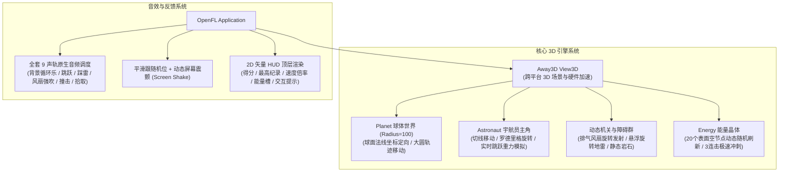

# Yellow Planet 3D (OpenFL + Away3D 现代化重构版)

本项目是将原 Flash Stage3D (Flare3D) 经典球形世界跑酷游戏 **Yellow Planet** 完整现代化重构至 **OpenFL + Away3D (Haxe)** 的全平台开源 3D 游戏工程。

> 🌐 **在线即开即玩 Demo**：[https://isamu2025.github.io/yellowPlanet/](https://isamu2025.github.io/yellowPlanet/)

---

## 一、技术栈与特性概览



### 重构核心亮点
- **语言与框架**：从旧版闭源 ActionScript 3 (Flare3D) 全面重写为现代 **Haxe 4 + OpenFL 9.5 + Away3D 5.0.9**。
- **脱离私有二进制黑盒**：将旧版私有 `.f3d` 格式与 `.fla` 资源完整解包并转换为通用 `.obj` 网格、标准 `.jpg/.png` 贴图与标准 `.mp3/.ogg/.wav` 音频。
- **纯正原版物理与计分体系**：
  - **精准踩雷加分**：空中踩爆地雷获得 `+100` 分并二次高弹跳，绕星球跑至背面自动刷新，可无尽循环游玩。
  - **能量收集与 Stage 进阶**：拾取能量晶体 `+300` 分，吃满 3 个进入结算并解锁下一 Stage 速度，通关奖励 `+3000` 分。
  - **帧率自适应与带鱼屏防抖**：采用真实时间增量归一化（Delta-Time Normalization），在 60Hz/120Hz/144Hz 屏幕及 21:9 超宽屏下均丝滑稳定，彻底消除风扇边缘视角抖动。
- **双端无缝发布**：
  - **HTML5 (Web)**：免插件在任何现代浏览器中通过 WebGL 极速 60FPS 流畅运行，支持 GitHub Pages 一键托管。
  - **Windows 桌面原生端 (HashLink / Neko)**：直接编译为独立原生程序。

---

## 二、游戏操作指南

- **开始 / 跳跃**：键盘 **【空格键 (Space)】**、**【方向键上 (Up)】**、**【W 键】** 或鼠标点击/触屏点击。
- **左右转向**：键盘 **【方向键左 / 右】** 或 **【A / D 键】**。
- **动态调速**：键盘 **【 - 】** 或 **【 [ 】** 减速；键盘 **【 + 】** 或 **【 ] 】** 加速。
- **核心玩法策略**：
  - 避开地表障碍岩石。
  - 空中踩爆地雷可连击得分并借力高跳；地面撞击地雷则游戏失败。
  - 巧用风扇进行大范围星球腾空侦查与位移。
  - 连续收集 3 个能量晶体提升常态移速与得分倍率。

---

## 三、编译与运行指南

进入项目根目录：`D:\ai\my-llm-test\gemini-3.8-flash\yellowPlanet`

### 1. HTML5 网页端运行（推荐，支持随时体验）
```bash
lime test html5
```
或者只编译静态网页文件：
```bash
lime build html5
```
编译产物位于 `Export/html5/bin/` 目录，可在任何静态 Web 服务器或浏览器中打开 `index.html`。

### 2. Windows 桌面原生端运行 (HashLink)
```bash
lime test hl
```
或者只编译独立 EXE：
```bash
lime build hl
```
编译产物位于 `Export/hl/bin/` 目录，可直接双击运行 [`YellowPlanet.exe`](file:///D:/ai/my-llm-test/gemini-3.8-flash/yellowPlanet/Export/hl/bin/YellowPlanet.exe)。

---

## 四、工程源码结构

- [`project.xml`](file:///D:/ai/my-llm-test/gemini-3.8-flash/yellowPlanet/project.xml)：OpenFL 工程配置文件，配置 Stage3D 深度缓冲、反锯齿与 Away3D 依赖。
- [`src/Main.hx`](file:///D:/ai/my-llm-test/gemini-3.8-flash/yellowPlanet/src/Main.hx)：核心游戏主类，包含场景初始化、Away3D 光影配置、球面物理运动学、碰撞检测、相机跟踪与 HUD 渲染。
- [`src/SimpleObjLoader.hx`](file:///D:/ai/my-llm-test/gemini-3.8-flash/yellowPlanet/src/SimpleObjLoader.hx)：自研的高性能零依赖 OBJ 几何解析器，支持顶点/UV/法线实时解构与 SubGeometry 重建。
- `assets/models/`：
  - `planet_floor.obj`：星球地表三维网格模型。
  - `astronaut.obj`：宇航员主角三维模型。
  - `mine.obj`：悬浮地雷三维模型。
  - `fan.obj`：排风扇三维模型。
  - `obstacles_combined.obj`：全场景静态障碍合批网格。
  - `scene_data.json`：由原版星球导出的所有出生点、机关与障碍精确定位数据。
- `assets/textures/`：星球贴图 (`planet_base1.jpg`, `planet_base2.jpg`)、宇航员贴图 (`astronaut.jpg`)、地雷贴图 (`mine_base.jpg`)、风扇贴图 (`Fan.JPG`) 等。
- `assets/audio/`：提取自原版 SWC 的全套音效（`StartSound.mp3`, `JumpSound.mp3`, `CoinSound.mp3`, `MineSound.mp3`, `FanSound.mp3`, `DeadSound.mp3`, `MusicSound.mp3`, `ResetSound.mp3`）。
- `export_assets.py`：资产自动化转换与 Blender 提取脚本。
